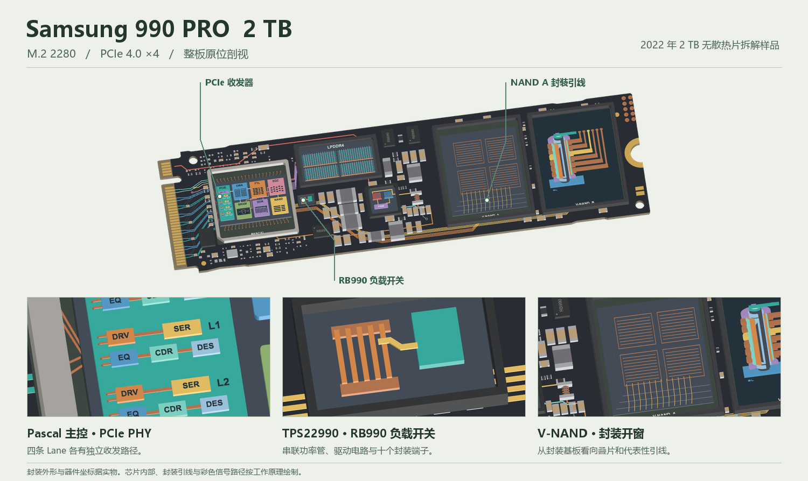
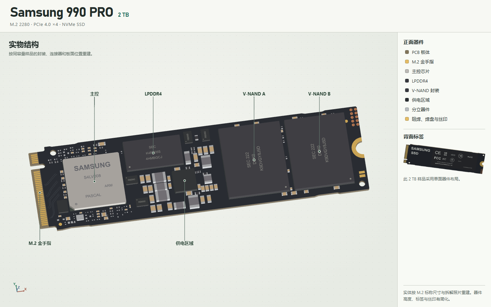
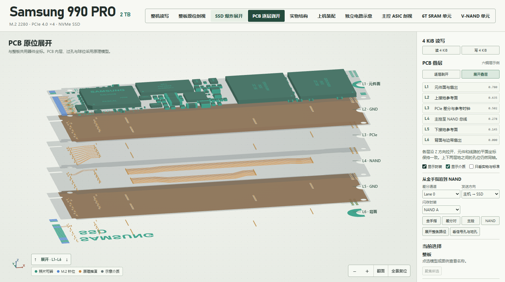
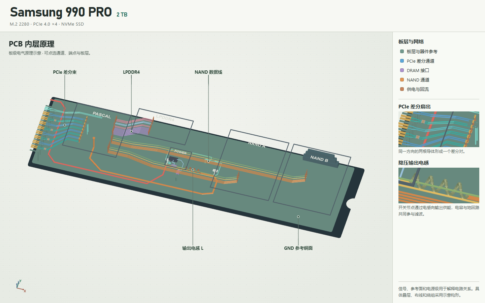
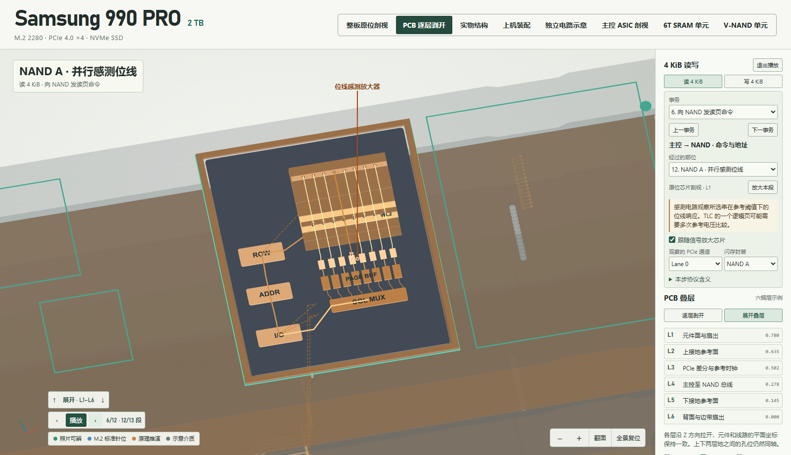
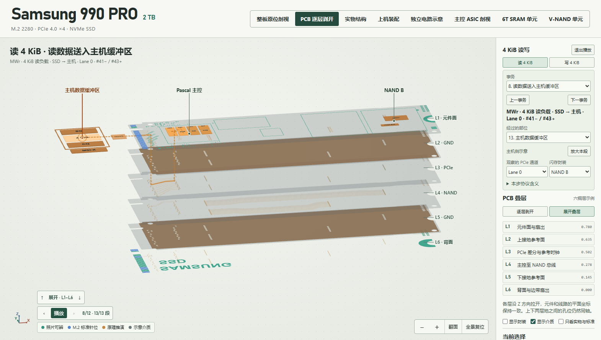
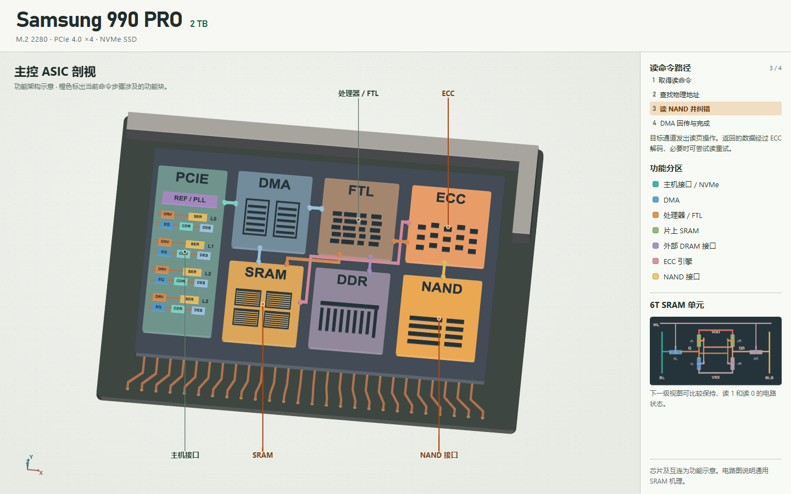

# 三星 990 PRO 2 TB · 实物与电路三维模型

[打开离线 3D 查看器](view.html) · [展开 SSD 本体](view.html#ssd-explode) · [打开 Framework 整机读写](view.html#system) · [进入原位 PCB 叠层](view.html#stack) · [分层装配 STEP](990-pro-2tb-layer-stack.step) · [整板原位剖视 STEP](990-pro-2tb-in-place.step) · [上机装配 STEP](990-pro-2tb-installed.step) · [实物 STEP](990-pro-2tb.step) · [独立电路剖视 STEP](990-pro-2tb-circuits.step) · [SSD 多场景 GLB](990-pro-2tb.glb) · [Framework 主板 GLB](framework-desktop.glb)

对象是 **Samsung 990 PRO 2 TB 无散热片版**。模型以 KitGuru 2022 年拆解的单面装片样品为基准。实物场景保留毫米尺度，电路场景则放大铜线、过孔、电极和芯片结构。三星资料给出 M.2 2280、PCIe 4.0 ×4、NVMe 2.0、2 GB LPDDR4、TLC V-NAND，成品最大包络为 80 × 22 × 2.3 mm。[三星原厂数据表，第 3 页](https://download.semiconductor.samsung.com/resources/data-sheet/samsung_nvme_ssd_990_pro_datasheet_rev.2.0.pdf#page=3) · [KitGuru 拆解样品](https://www.kitguru.net/components/ssd-drives/simon-crisp/samsung-990-pro-2tb-review/2/)

## 从一块板看到一位数据

打开 `view.html` 即可看到**整板原位剖视**。PCB、金手指、焊点、周边小件与十处可聚焦剖面共用同一坐标系。点板上的「电感绕组」会放大供电 IC 右侧的电感，「片上 6T SRAM」会放大银色主控边框内的位单元，「RB990 负载开关」会放大主控旁一颗独立功率开关。拖动旋转，滚轮或双指缩放，单击识别，双击聚焦。「全景复位」回到整板。「实物结构」保留相机角度和倍率，便于将窗口与原封装对齐比较，「翻面」可在当前倍率下对准同一位置观察背面。查看器离线运行。

在 PCB 叠层切换铜层时，侧栏说明该层在布线和回流中的作用。进入读写回放后，说明跟随当前事务和芯片内部节点。展开「换个条件会怎样」会暂停回放，可停下来对照原因和后果。[参考面与回流路径](https://www.ti.com/lit/an/spraar7j/spraar7j.pdf) · [NAND 纠错与存储组织](https://www.micron.com/products/storage/nand-flash/choosing-the-right-nand)

| 想观察的细节 | 直接进入 |
| --- | --- |
| 看 SSD 从标签、芯片封装到 PCB 铜层依次分离 | [SSD 爆炸展开](view.html#ssd-explode) |
| 在 Framework Desktop 装配环境里从主机内存追到 NAND，再送回主机 | [整机读 4 KiB](view.html#system/read) · [整机写 4 KiB](view.html#system/write) |
| 分开主槽的固定螺钉、散热片、导热垫和 SSD | [播放装配爆炸动画](view.html#system/explode) |
| 看 Framework 正面主槽的针位与读数据落入主机缓冲区 | [正向到 JSSD1](view.html#system/read/2/host_contact) · [读数据落入缓冲区](view.html#system/read/8/host_data) |
| 在同一叠层里播放一次读写，按段看信号跨过金手指、过孔、主控和 NAND | [播放读 4 KiB](view.html#stack/read) · [播放写 4 KiB](view.html#stack/write) |
| 芯片自动原位放大，单步观察 NAND 感测以及主控的纠错与搬运 | [选中字线 WL2](view.html#stack/read/6/wordline) · [ECC 检查综合征](view.html#stack/read/7/ecc_check) · [DMA 找到主机缓冲](view.html#stack/read/8/dma_addr) |
| 看读出的 4 KiB 由 SSD 送入主机内存 | [定位读数据回传](view.html#stack/read/8/end) |
| 保持同一块板的位置，剥到 PCIe 差分层，或把所有铜层沿 Z 拉开 | [进入 L3](view.html#stack/3) · [展开 L1–L6](view.html#stack/explode) |
| 放大卡边一对镀铜孔与地参考面的避空，再看换层回流 | [信号孔与地孔](view.html#stack/vias) |
| 追踪主控到 NAND B 的内层总线与封装端 | [沿 L4 到 NAND B](view.html#stack/nand/b) |
| 同时高亮一条 PCIe 链路、主控转接和对应的 NAND 总线 | [展开整条路径](view.html#stack/route) |
| 在主控原位区分发送串化器和驱动器、接收均衡与时钟恢复、共用参考时钟 | [Pascal 上的 PCIe PHY 窗口](view.html#zone/phy) |
| 辨认中央供电区旁边的 RB990 负载开关、功率 MOS 及其驱动 | [RB990 原位剖视](view.html#zone/switch) |
| 从供电、复位和参考时钟开始，看两端训练到 Gen4 ×4 | [建立链路](view.html#train) |
| 看一次 NVMe Read 的 4 KiB 数据从 SSD 经哪一对触点回主机 | [Lane 0 的读数据阶段](view.html#read/8/0) |
| 比较 SSD 发出的 Memory Read 请求与随后反向返回的写负载 | [Lane 0 的写数据请求](view.html#write/5/0) |
| 打开插座上盖，看两排金属簧片分别接触卡边的哪一面 | [上机装配 · 插座](view.html#mount/socket) |
| 提起螺钉，观察定心颈进入半孔、承面支撑卡底的位置 | [上机装配 · 固定端](view.html#mount/fix) |
| 从背面揭开标签的印刷层，观察中右部铜箔的覆盖范围 | [背标铜箔](view.html#thermal) |

选择「放大落点」可以沿真实卡边针号追到主控。箭头依附于三维线路，会随相机旋转和缩放。选择单条 Lane 方便辨认这一对触点，×4 链路会使用所有活动 Lane。主机填写队列或检查完成项时，画面显示主机本地操作。引脚方向由两端接口定义约束，彩线的位置与逐步事务为工作原理推演。[PCIe 引脚、链路训练与流控依据](pcie-link-evidence.md) · [NVMe 事务和板内数据路径依据](io-path-evidence.md)

主控左侧的 PCIe 窗口含四组收发器。发送端把并行字串化后交给差分驱动器。接收端均衡信号、恢复采样相位，再解串成并行字。边缘铜线从卡边延伸到对应收发器的示意端口。选择 PCIe 事务方向时会同时点亮对应触点、封装引线及片上通路。前端的排布和时钟资源共享方式采用功能模型。[接收均衡与时钟恢复原理，第 3–5 页](https://download.tek.com/document/Understanding%20Transition%20Gen4%20Enterprise%20Datacenter%20I_O%20Standards%2065W_61047.pdf#page=5)



[整板标注视图](in-place-preview.png) · [一次 4 KiB 读数据回传的交互画面](link-preview.png) · [压平固定后的上机装配画面](installation-preview.png)

主控窗口保留镀镍边框，窗口里绘制功能区、片上互连和 SRAM 内部的六只晶体管。板载 LPDDR4 窗口展示成组的字线、位线和感测放大器带。中央供电区打开 IC、一颗磁性器件和一颗片式陶瓷电容，能看到功率管指状结构、两端间的铜绕组，以及交替连接端头的两组内电极。板上彩线可单独开关。器件位置对应真实样品，电源网络连接、绕组形式、电极层数与阵列布局均为原理取样。[MIT 存储阵列原理](https://ocw.mit.edu/courses/6-004-computation-structures-spring-2017/pages/c14/c14s1/) · [村田多层陶瓷电容的电极与叠层](https://www.murata.com/support/faqs/capacitor/ceramiccapacitor/conf/0002)

同一块板上的两颗 NAND 选择了不同剖切尺度。A 在封装开口内展示多枚裸片与引线，B 把一根垂直存储串的纵剖沿裸片表面展开，让字线、沟道与陷阱层从整板视角也可见。两颗实物都是 TLC，模型中的缩放、剖切方向和示例片数用于阅读。

| 视图 | 可以实际查看的结构 |
| --- | --- |
| SSD 爆炸展开 | 正背标签、背标铜箔、主控、LPDDR4、两枚 NAND 与周边器件沿板面法线分离，随后拉开六层铜和层间介质。可暂停、拖动进度或反向合拢。 |
| 整机读写 | Framework Desktop 的 170 × 170 mm 主板、正面 JSSD1 和已对位的 990 PRO。可显示或隐藏原厂散热片，放大插槽，连续单步查看主机内存、主板、金手指、主控和闪存。 |
| 整板原位剖视 | 十个原位放大入口。八对 PCIe 数据线、发送侧串联电容、REFCLK、来自背面触点的 PERST# 与 CLKREQ#，以及主控与板载存储的代表性信号线。可在整板上逐步追踪建链、读与写。 |
| PCB 逐层剥开 | 沿用整板与封装坐标。逐层揭开六铜层示例，展开铜与介质，点选导体、孔壁及参考面，并分阶段追踪金手指、主控和 NAND。 |
| 上机装配 | 67 枚弹片各自从金手指接到板侧 SMT 焊盘。可剖开插座盖、隐藏主板、沿轴线提起螺钉，看 M 键和定心肩柱怎样约束卡体。 |
| 实物结构 | 双面金手指、M 键、末端固定半孔、工艺孔、10 枚双面孔、独立贴片与端头、镀镍主控、板载 DRAM、两枚 NAND、正背贴纸。 |
| 独立电路示意 | 放大演示 PCIe、LPDDR4 和 NAND 的线组，以及完整的一路降压供电回路。 |
| 主控 ASIC 剖视 | 从 BGA 焊球、封装基板扇出、芯片侧凸点进入功能区。切换读写流程，逐步查看 NVMe 前端、DMA、固件与 FTL、片上 SRAM、DRAM 接口、ECC 和 NAND 后端。 |
| 6T SRAM 单元 | 从主控 SRAM 进入。可以选择保持 Q=1、读 Q=1、读 Q=0，比较两根预充位线中的哪一根放电。 |
| V-NAND 单元 | 左边展示封装中多枚裸片的堆叠，右边放大其中一根垂直存储串。可点选字线、沟道、隧穿介质、陷阱层、两端选择栅、位线和共源线，并查看 TLC 的八个阈值窗口。 |



## 实物特征与复原精度

俯视元件面时，金手指在左，固定半孔在右。坐标原点在插入端的名义板框角，X 沿板长，Y 沿板宽，Z 指向元件。正反面共用坐标。可分离的金手指为 34 个正面奇数触点和 33 个背面偶数触点，M 键占 #59–66 的空位。同面触点节距 0.50 mm。两侧肩部、双面导入倒角、开槽和半孔按连接器厂商的卡图绘制，长边局部的小退让与两个工艺圆孔按样品照片绘制。[ACES 推荐卡图，第 13 页](https://www.acesconn.com/upload/product_file/SPEC-51765-075xx-xxx%20rev-A.pdf#page=13) · [E-tec M-key 推荐卡图，第 2 页](https://www.e-tec.com/v5/documents/pdfs/pcb-interconnect-products/mpe-075-remr9-95.pdf#page=2)

| 从接口向右 | 图上中心 X、Y（mm，近似） | 可以判断的内容 |
| --- | --- | --- |
| 主控 | 14.65，11.04 | 近方形 Samsung Pascal，银色镀镍表面，左下有倒角。 |
| DRAM | 29.74，16.50 | 2 GB LPDDR4，位于主控右上方。同容量微距读出 K4F6E6S4HM-BGCJ。 |
| 四颗负载开关 | 23.55，10.25 / 25.24，4.17 / 38.62，19.47 / 42.83，19.50 | 均可辨认 RB990 顶标，对应 TI TPS22990。WSON-10 本体 3 × 2 mm，底部散热焊盘接 VIN。每颗所控电源轨未知。 |
| 供电区 IC | 36.21，8.26 | 方形黑色封装，邻近磁性器件与去耦元件。电源功能按布局推断，料号未确认。 |
| NAND A / B | 53.53，11.21 / 69.42，11.19 | 同一块板上的两枚 V7 TLC V-NAND 封装。拆解者给出 176 层，容量与代际以该样品为限。 |

模型还收录 **101 个可辨本体的周边小器件、81 个独立可见锡色端点、4 个露铜点和 8 段可见表层扇出**。无源件按外观分类，阻值、电容量和电感量未知。用 80 × 22 mm 定标的照片平面位置估计精度约 0.2–0.6 mm，正反面共同参照重投影偏差约 0.27–0.36 mm。文件中的三位小数保留建模坐标。0.80 mm 板厚、各封装高度、镀层和标签厚度为模型取值。含标签的成品模型包络约 **80 × 22 × 2.058 mm**。[坐标、丝印分歧及逐项照片依据](board-evidence.md) · [实测图像定位数据](board-layout.json) · [正面揭标原片](https://www.kitguru.net/wp-content/uploads/2022/10/Samsung-SSD990-PRO-2TB-Review-on-KitGuru-PCB.jpg)

背面有独立的 SAMSUNG SSD 板上印字、中右部含铜标签、金手指与孔阵列。TechPowerUp 的同容量样品提供了完整揭贴的背面照，标签下露出连续黑色阻焊，未见背装封装。「实物结构 → 翻看背标铜箔」可揭开印刷层，看到铜箔实际覆盖的区域与主控中心的相对位置。三星说明从 2023 年 9 月起该系列混用 V7、V8 工艺，模型中 V7 的判定对应 2022 年拆解样品。[同容量去标背面实拍](https://tpucdn.com/review/samsung-990-pro-2-tb/images/pcb2.jpg) · [原样品背标](https://www.kitguru.net/wp-content/uploads/2022/10/Samsung-SSD990-PRO-2TB-Review-on-KitGuru-DriveRear.jpg) · [三星固件支持页的生产变更说明](https://semiconductor.samsung.com/consumer-storage/support/tools/)

**卡怎样安装。** 本模型选用主板侧 TE 1-2199119-5 M-key 插座和 JAE SM3ZS067U310-NUT1 有肩柱。插座前唇从卡前缘向板内覆盖约 4.25 mm，67 个弹片分接正面 34 个和背面 33 个金手指。插座定位轴线到尾部螺柱轴线为 78.25 mm。示例把 0.05 mm 焊接层计入安装高度，板底离主板 1.50 mm。Ø3.00 mm 柱颈伸入 Ø3.50 mm 的卡尾半孔，上方 Ø4.80 mm 螺头压住镀环。弹片曲线、螺纹外形及示例主板外廓经过简化。[器件照片与装配尺寸逐项来源](mechanical-detail-evidence.md) · [TE 插座规格与原厂 CAD 入口](https://www.te.com/en/product-1-2199119-5.html)

## 沿着板内电路走一遍

在「PCB 逐层剥开」中可以依次露出 L1 的装配和扇出、L2 上地面、L3 差分线、L4 NAND 总线、L5 下地面和 L6 背面。也可以沿 Z 方向展开各层，同时保持金手指、主控和 NAND 的平面坐标。从「从金手指追到 NAND」选择 Lane、方向与封装，每一步会点亮对应路线和过孔。「显示封装」恢复器件外形，便于对齐焊盘。「只看实物与标准」保留青绿色表面证据与蓝色标准针位。琥珀色铜线、孔壁和参考铜面以及灰色介质来自六层示范叠层。原产品的层数和隐藏布线仍需截面或板厂资料核定。[颜色定义、层深和逐段来源](layer-stack-evidence.md)



[信号孔、反焊盘与地孔的放大画面](layer-stack-vias.png)

**PCIe**　每条 Lane 有一对发送线和一对接收线，×4 合计八对、十六根数据导体。端点按 M-key 的 PET/PER 引脚放置。例如 Lane 0 的两对分别位于 #41/43 与 #47/49，参考时钟位于 #53/55。旋转视图能看到一对线的两根独立孔柱及相邻接地回路。金手指位置取自接口资料，封装侧焊盘坐标、路线、层序与介质厚度为原理示意。[研华同接口 SSD 引脚表，第 12–13 页](https://advdownload.advantech.com/productfile/Downloadfile3/1-2VEJUIE/Advantech%20SQFlash_PCIe%20NVMe%20M.2%202280_M%20Key_720-D-DS_v1.13_20241223.pdf#page=12)

在 Lane 0 上，**#41−/43+ 从 SSD 发往主机，#47−/49+ 从主机发往 SSD**。四对 SSD TX 上各有两枚等效串联电容，切断的铜线分别接到电容两端。反方向的耦合电容位于主机发送侧。点「PCB 逐层剥开 → 看信号孔与地孔」可见差分导体各自的镀铜孔壁、接地面围绕信号孔的避空区，以及接到两层参考面的地孔。图中孔径、层距与折线用于观察结构，PCB 阻抗与实板过孔位置需要板厂资料或测量。[NVIDIA 载板原理图第 21 页](https://cdck-file-uploads-global.s3.dualstack.us-west-2.amazonaws.com/nvidia/original/4X/e/4/f/e4f818c957d9553c250c863222d723bc3bb07c30.pdf#page=21) · [PCIe 端点引脚和耦合依据](pcie-link-evidence.md)

**DRAM 和 NAND**　DRAM 分支画出一个 DQ 字节组、DQS、CK 和若干 CA 线。NAND 分支用代表性的 DQ、DQS 和 CE# 表示数据、选通和片选。NAND 输出读突发时驱动 DQ/DQS，主控写入时反向驱动。三星同代 176 层研究芯片公开了 Toggle DDR 5.0 接口，990 PRO 拆解样品的实跑速率、通道交织与球位仍未知。每枚封装可含多枚裸片。[Microchip 的 LPDDR4 信号表](https://onlinedocs.microchip.com/oxy/GUID-FF8061A7-7A15-470F-A6F5-E733C24D85F0-en-US-11/GUID-4EFEDBB8-4C3B-4CDD-ADED-3E4F078D4595.html) · [三星 ISSCC 2021 论文](https://doi.org/10.1109/ISSCC42613.2021.9366054) · [NAND 接口和时序依据](io-path-evidence.md)

**板上电源**　从 3.3 V 触点出发，可以依次看到输入电容、同步半桥高低侧开关、开关节点 SW、电感绕组、输出电容和主控负载。输出通过分压器回到调节器，两根驱动线分别去高侧和低侧 MOS 栅端。高侧接通时向电感供能，低侧接通时电感续流，输出电容减小纹波。该例仅跟踪一路输出，电气参数、补偿、实际 PMIC 通道数及电源排序未知。[Analog Devices 开关稳压原理与反馈回路](https://www.analog.com/en/resources/app-notes/2020/05/12/19/12/an-140.html)



## 主控如何完成一次读写

「跟随信号放大芯片」默认开启。流程进入 NAND 和 Pascal 时，镜头沿同一块板的坐标放大相应封装。发往 L4 闪存总线或 L3 PCIe 差分对时，镜头回到叠层全景。用 ‹ / › 或「经过的部位」单步查看。打开「只看实物与标准」后，芯片近景保持当前视点，改为显示照片确认的封装外形。



NAND 内部画出行地址锁存、块和字线译码、串选择栅、位线、感测放大器、页缓冲和列复用器。Pascal 内画出 NAND PHY 采样、ECC 检查与纠正、工作缓冲、DMA 和 PCIe TX。ECC 窗口用一个 7 位汉明码演示综合征和位翻转，码型与几何均为示例。[各子步骤、例题及协议依据](io-path-evidence.md#芯片内部的逐步剖视)

在「PCB 逐层剥开」里选「读 4 KiB」或「写 4 KiB」，按「播放」后，箭头会依次点亮经过的针位、铜线、过孔和芯片功能区。暂停时可用视图下方的 ‹ / › 单步，也可以在侧栏跳到某个事务或某段过孔。展开模式显示跨层全程，剥开模式逐段选中对应铜层。主机侧的 SQ、4 KiB 缓冲区、CQ 和 MSI-X 目标采用与板内推演相同的琥珀色。



在 NVMe Read 的回传阶段，SSD 发出 PCIe Memory Write，把读数据写进主机缓冲区。NVMe Write 则先有 SSD 发出的 Memory Read，随后主机用带数据的 Completion 返回待写内容。模型用一条选中的 Lane 展示 PCIe ×4 的物理路径，主机区与芯片内部是功能示意，播放节奏按观察需要设置。[4 KiB 读写与播放说明](io-path-evidence.md)

| 阶段 | 读一个逻辑块 | 写一个逻辑块 |
| --- | --- | --- |
| 主机接口 | 主机将命令放入提交队列并写门铃，设备取命令和主机缓冲区描述。 | 设备取写命令，通过 DMA 从主机缓冲区读取数据。 |
| 地址与缓存 | 固件通过 FTL 确定物理页；热映射和工作数据可在 SRAM 或外部 DRAM 命中。 | 分配可写物理页并准备更新逻辑到物理的映射。 |
| 介质与纠错 | NAND 后端发读页命令，返回的码字由 ECC 解码；必要时可重试读取。 | ECC 产生冗余，后端发编程命令并检查状态。实际写入也可能经过缓存。 |
| 返回 | DMA 把数据传给主机，在完成队列写入结果。 | 固件按策略维护映射并报告完成。主机能依赖的持久性还取决于易失写缓存配置、FUA 和 Flush。 |

这两条流程说明一次访问 NAND 时的数据路径。DMA 搬运数据，FTL 属于固件与工作存储共同实现的功能，ECC 负责校验和纠错。图中的功能块布局、颜色、相对面积、焊球与凸点阵列均为解释结构而设计。没有采用三星 Pascal 的裸片显微图、GDS、球位表、原理图或 PCB 内层数据。LDPC 只作为业界纠错机制举例。[NVMe over PCIe 1.0，队列模型](https://nvmexpress.org/wp-content/uploads/NVMe-over-PCIe-Transport-Specification-1_0-2021.06.02-Ratified-1.pdf) · [MQSim 论文与 SSD 架构模型](https://www.usenix.org/conference/fast18/presentation/tavakkol) · [Microchip 公布的闪存控制器架构与 ECC](https://www.microchip.com/content/dam/mchp/documents/DCS/ProductDocuments/Brochures/00003489E.pdf)



**看一位 SRAM**　两只 PMOS 和两只 NMOS 构成两个交叉耦合的反相器，另外两只访问 NMOS 共用字线 WL。保持时 WL 低，Q 与 QB 互补。读前先预充 BL/BLB，再拉高 WL。若 Q=1，BLB 经右侧访问管和下拉管略微放电。若 Q=0，放电的是 BL。视图把七个网络做成立体金属线，在反馈线交叉处用不同高度隔开。[MIT 6.004 SRAM 阵列与读出](https://ocw.mit.edu/courses/6-004-computation-structures-spring-2017/pages/c14/c14s1/) · [汉堡大学 6T CMOS 单元](https://tams-www.informatik.uni-hamburg.de/applets/sram/)

**看一串 NAND**　封装叠片与一枚裸片内部的字线堆叠使用两个独立放大比例。右侧只画六个示例存储字线及两端选择栅。旋转切开的垂直串可以依次辨认填芯、多晶硅沟道、隧穿介质、电荷陷阱、阻挡介质和外侧控制栅。存入的电荷改变阈值，TLC 用八个阈值窗口编码三个比特。一次选中的单元处于其中一个状态；窗口位置、材料厚度及码字未使用三星专有数据。[三星 V-NAND 与电荷陷阱说明](https://semiconductor.samsung.com/news-events/tech-blog/the-next-phase-of-v-nand-ingenuity/) · [垂直串径向结构的器件研究](https://www.mdpi.com/2079-9292/14/7/1461) · [TLC 阈值分布的实测与建模](https://www.mdpi.com/2079-9292/10/18/2306)

## SSD 本体爆炸展开

打开顶部「SSD 爆炸展开」可自动播放。正面标签和背标先离板，背标的胶层、铜箔和印刷层继续分开。随后 Pascal 主控、LPDDR4、NAND A/B、供电器件和小件从各自的焊盘上方抬起，最后拉开 PCB 的六铜层示例。「合拢」沿路径反向回到实物重建的装配姿态。侧栏可跳到标签、芯片或铜层，点选器件可以查看名称和资料依据。[打开爆炸展开](view.html#ssd-explode) · [完全展开预览](ssd-explosion-preview.png)

拉开 PCB 后，青绿表示照片可辨的表面特征，蓝色表示标准针位，琥珀色表示推演的差分线、过孔、接地面和 NAND 总线。可隐藏介质片以观察铜层，也可以隐藏推演保留实物重建的封装和外部特征。芯片封装位置取自拆解，板内堆叠及展开间距为演示值。[实物定位依据](board-evidence.md) · [PCB 分层依据](layer-stack-evidence.md)

## Framework Desktop 整机读写

「整机读写」载入 Framework Desktop 的原厂装配几何，并用 990 PRO 模型替换正面主槽参考盘。可翻面、聚焦插槽或显示热扩散片。散热片使用原厂参考盘的闭合位置，实际压合间隙和导热垫压缩量仍待核验。[原厂装配及尺寸依据](host-board-sources.md#framework-desktopamd-ryzen-ai-max-300-系列)

[整机读写预览](system-io-preview.png) · [爆炸展开预览](system-explosion-preview.png)

「爆炸展开」依次抬升固定螺钉、分开散热片和导热垫，再让 990 PRO 抬尾退出 JSSD1。可暂停、拖动进度条、反向合拢和重播。动画以主板、插座和尾部固定柱为基准，展开间距和抽卡角度用于演示。「返回整机」可从暂停处继续 4 KiB 流程。[直接打开爆炸动画](view.html#system/explode)

按「读 4 KiB」或「写 4 KiB」选流程，按播放键启动。暂停后的 ‹ / › 会跨事务单步，也可以从侧栏跳转。镜头跟随当前段在主机内存、整块主板、插座、SSD 内层和芯片剖面间切换。在读流程中，返回的数据和完成项分别写入 4 KiB 缓冲区与完成队列 CQ。侧栏支持选 Lane 0–3 和 NAND A/B。关闭镜头跟随可保持当前视点。[读数据经过主板](view.html#system/read/8/host_link) · [定位完成队列](view.html#system/read/9/host_cq)

灰蓝色是主板装配 CAD，青绿色表示照片可辨的 SSD 结构，蓝色表示原厂接口图和标准针位，琥珀色表示推演的电气路径、逻辑内存地址和芯片内部。勾选「隐藏推演」可在同一流程中只看已有依据的结构和针位。主板模型源自 Framework Computer Inc.，采用 CC BY 4.0。本项目重新着色、对位、隐藏参考盘并增加了功能标记。[资料、许可和对位坐标](host-board-sources.md)

## 在 CAD 里继续编辑

- 实物 STEP 的单位为 mm，按板体、卡边、芯片、周边和贴膜分组。隐藏正面贴膜便可看到裸板。电路 STEP 将四幅原理模型分别作为独立子装配，平铺放置。
- 整板原位剖视 STEP 的单位也为 mm，所有芯片窗口和周边器件采用实物的同一装配原点。主控、内存、供电、绕组、电容和两颗 NAND 各自分组，便于隐藏、测量和继续编辑。
- 上机装配 STEP 使用同一卡边原点和毫米单位。螺钉处于压紧位置。插座上盖、弹片、两排焊盘、承柱、主板与 SSD 可分别隐藏或测量。
- 分层装配 STEP 使用同一原点及毫米单位，按 L1–L6 分组。孔壁在压合时同轴接合，装配树可分别隐藏各层或将其沿 Z 移开。
- GLB 使用米、Y 向上，默认整板原位剖视。它还包含实物、上机装配、PCB 原位叠层，以及 PCB、主控、SRAM 和 NAND 四幅独立放大图。线路节点记录方向、针号或层号、网络和证据类别。
- Framework 主板 GLB 采用同样的米制和卡边坐标。可与 SSD GLB 的实物场景按原点叠放。`framework_host.py` 可从指定版本的原厂 STEP 重新生成主板 GLB，详细入口在主板资料页。更新查看器时可运行 `uv run --python 3.11 build_model.py --viewer-only`。
- 编辑 `board-layout.json` 可更改照片定位数据，`m2_card.py` 定义卡边几何。`physical.py` 生成器件和印字，`inplace.py` 将剖面嵌进对应封装。`viewer/` 含查看器界面与交互源码。[零件与包络清单](parts.csv)

在本目录执行以下命令。构建脚本同步刷新五份 STEP、GLB、零件清单及离线查看器。`stack_board.py` 定义原位层深、铜面与布线，`viewer/stack.js` 控制剥层、展开及追线。`installation.py` 定义主板侧机械结构，`link-guide.json` 存放建链与读写说明。验证脚本检查实物干涉、STEP 回读、67 枚弹片的接触、差分对与 NAND 总线的接续、信号孔避空和地孔回流，以及原位剖面位置与独立 6T 单元的十八个端子。

```powershell
uv run --python 3.11 build_model.py
uv run --python 3.11 verify_model.py
```

分层装配 STEP 回读得到 **1,686 个实体**，已核对四条 Lane 的八对数据线、两组各 15 根的 NAND 总线、镀铜孔壁的接续、地孔接地与信号避空。实物、整板原位剖视、上机装配和独立电路 STEP 分别含 901、1,471、1,018 和 1,150 个实体。离线 Chrome 和 Edge 验证了六级剥层、展开、取证筛选、沿板追线、十处原位聚焦及翻面。
